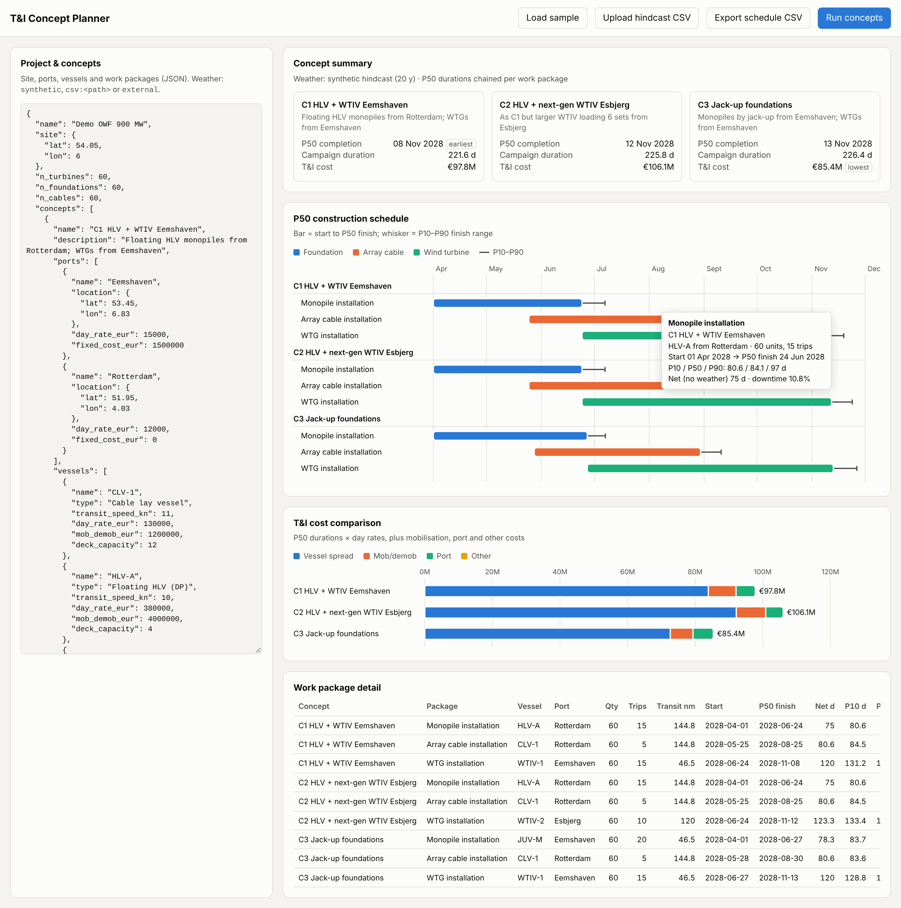

# T&I Concept Planner (MVP)

Builds offshore-wind **transport & installation (T&I) concepts** end-to-end: define concepts
(ports, vessels, work packages) → weather-downtime simulation → **P50 schedule (Gantt)** and
**cost comparison** across concepts. It replaces the Excel chain: downtime tool → cost tool → Gantt.



## Run
```bash
pip install -r requirements.txt
uvicorn app.main:app --reload      # open http://localhost:8000
pytest -q
```

## How it works
1. **Input** (`data/sample_project.json`): site coordinates, number of components, and one or more
   concepts. Each concept has ports (coordinates, day rates, fixed upgrade cost), vessels (speed,
   day rate, mob/demob, deck capacity) and **work packages** (e.g. monopiles, array cables, WTGs).
   A work package has load-out steps at port and installation steps at site, each with a duration and
   weather limits (Hs, wind), transit limits, and a fixed start date or a dependency (`after` + `lag_days`).
2. **Sequence builder** (`app/engine.py`): expands each package into a full activity sequence
   (load units → transit out (distance port→site ÷ speed) → install each unit / move infield → transit back)
   × number of trips (`ceil(quantity / deck_capacity)`).
3. **Weather downtime engine** (`app/weather.py`): a pluggable interface, `simulate(steps, start, years)`.
   - `synthetic`: built-in persistence simulation on a generated North-Sea-like hindcast (demo only).
   - `csv:<path>`: the same simulation on your own hourly hindcast (`time,hs,ws` CSV, upload it in the UI).
   - `external`: HTTP adapter for a third-party downtime tool (`TNI_EXTERNAL_URL`, `TNI_EXTERNAL_TOKEN`).
     Adapt `_to_payload` / `_from_response` to that tool's API.
   Each step is non-splittable and needs a continuous workable window; the sequence is simulated for each
   hindcast year from the same calendar start date, giving P10/P50/P90 durations.
4. **Schedule & cost**: packages are chained on P50 finishes. Cost = vessel day rate × P50 days +
   mob/demob (once per vessel) + port day rate × P50 days + port fixed cost (once per port) + extras.

## API
- `GET /api/sample` – example project
- `POST /api/run` – project JSON → per-concept, per-package P10/P50/P90, dates, costs
- `POST /api/hindcast` – upload hindcast CSV → `weather` key to use

All numbers in the sample (rates, limits, durations) are illustrative placeholders.
